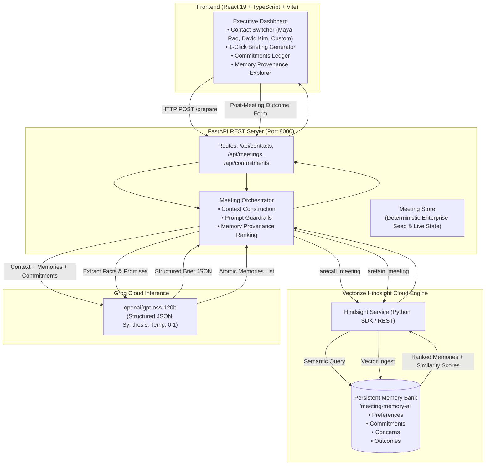
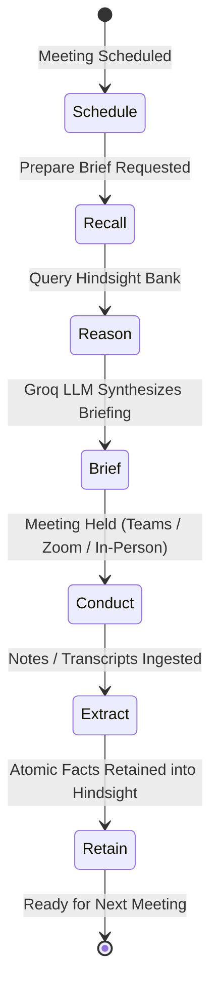

# Meeting Memory AI — Technical Documentation & Architecture Whitepaper
**Pre-Meeting Executive Briefings Backed by Persistent Relationship Memory**

[](https://hindsight.vectorize.io/)
[](https://ui.hindsight.vectorize.io)
[](https://console.groq.com)
[](https://fastapi.tiangolo.com)
[](https://vitejs.dev)

---

## 1. Executive Summary

In high-stakes business environments—such as enterprise B2B sales, account management, and strategic partnerships—professionals frequently meet with the same key clients and stakeholders over weeks, months, or years. 

Today's AI chatbots suffer from a critical limitation: **they are completely stateless**. Each conversation starts from a blank slate, forcing professionals to manually reconstruct context from scattered CRM logs, slide decks, and messy email chains. When an AI forgets that an executive specifically requested high-density bullet points, or when account reps forget promises made two weeks prior, trust is broken.

**Meeting Memory AI** solves this problem by using **Vectorize Hindsight Cloud** as a persistent, long-term memory engine. Before every call, the agent recalls past decisions, communication preferences, objections, and open deliverables, synthesizing an actionable executive briefing in seconds. After the meeting, it extracts newly formed commitments and updates Hindsight Cloud, establishing a continuous learning loop where **every future meeting is demonstrably smarter than the last**.

---

## 2. Problem Statement & Hackathon Alignment

### The Official Hackathon Challenge
This project was developed for **HackWithHyderabad 3.0** under the official theme:  
> **"AI Agents That Learn Using Hindsight"**  
> *"Memory allows agents to remember, recall, and improve over time. A great project should solve a real business problem, make memory central to the value proposition, show improvement over multiple interactions, and keep scope tight."*

### Why Meeting Preparation?
Topic #15 in the official problem statement explicitly outlines the **Meeting Prep Agent**:
> *"It remembers past meetings, commitments, missed follow-ups, meeting style, and preparation preferences. Before every meeting, generate a concise, evidence-backed briefing from everything the agent has learned about the contact."*

### The Core Failure Modes Solved
1. **Lost Executive Preferences**: Failing to remember that a VP hates marketing jargon damages credibility immediately.
2. **Dropped Commitments**: Promises made by both parties ("we'll deliver the SOC2 report by Sept 18"; "client will send EDI schema samples") fall through the cracks without a unified ledger.
3. **Stateless Re-Discovery**: Reps waste the first 10 minutes of critical meetings re-asking questions already answered in previous calls.

---

## 3. High-Level Architecture

The system is architecturally decoupled into three clean tiers:
1. **Presentation Layer**: React 19 + TypeScript + Vite with a high-contrast dark glassmorphism interface (`#090d16`).
2. **Agent & Orchestration Layer**: FastAPI REST backend coordinating memory recall, prompt construction, and schema validation.
3. **Intelligence & Memory Layer**: **Vectorize Hindsight Cloud** for semantic vector memory storage & Groq (`openai/gpt-oss-120b`) for rapid reasoning.



---

## 4. The Hindsight Memory Lifecycle

The system treats memory as a continuous 6-stage lifecycle rather than a single database lookup:



1. **Observe & Scrape Context**: The agent reads the upcoming meeting title, objectives, attendees, and contact ID.
2. **Semantic Recall**: Vectorize Hindsight Cloud queries the `meeting-memory-ai` bank using contact-scoped semantic queries:
   ```python
   retrieval_query = f"{contact.name} {contact.company} {meeting.title} {meeting.objective} commitments preferences concerns"
   recalled_memories = await hindsight_service.arecall_meeting(
       contact_id=contact.id, query=retrieval_query, limit=8
   )
   ```
3. **Context Construction & Guardrails**: Retrieved memories are filtered and formatted alongside unresolved commitments. The system instruction strictly enforces:
   * *Formatting constraints based on recalled executive preferences.*
   * *Explicit accountability tracking (Us vs Them).*
   * *Zero hallucination (only provided facts and memories are referenced).*
4. **LLM Synthesis**: Groq (`openai/gpt-oss-120b`) generates a structured [MeetingBrief](file:///c:/Users/G%20SAI%20SHARANYA/Downloads/Hyderabad%203.0%20Microsoft%20Hackathon/backend/app/schemas_meeting.py) containing:
   * **Meeting Overview & Strategic Goal**
   * **Signature Feature: "Change Since Last Meeting"** (What's new, unresolved deliverables, priority questions)
   * **Why This Briefing? Provenance Badges** (Exact Hindsight vector memories with similarity scores like `0.995`)
5. **Post-Meeting Knowledge Extraction**: Raw user notes or call transcripts are decomposed into atomic, categorized memories:
   * `preference` (e.g. *"Prefers architectural diagrams over slide decks"*)
   * `concern_objection` (e.g. *"Must guarantee sub-50ms p99 latency during peak trading"*)
   * `commitment` (e.g. *"Maya promised to deliver EDI schemas by Sept 20"*)
   * `decision` (e.g. *"Approved 30-day sandbox pilot on German routes"*)
   * `relationship_fact` (e.g. *"Manages 450,000 daily manifests across 12 hubs"*)
6. **Persistent Ingestion**: Each atomic fact is retained into Hindsight Cloud tagged with `contact_id`, ensuring permanent cross-meeting continuity.

---

## 5. Enterprise Multi-Contact Scoping & Memory Isolation

A production-grade memory system must isolate context between different executives and companies (Rule 16). **Meeting Memory AI** features native multi-contact isolation:

### Persona 1: Maya Rao (Logistics & Supply Chain)
* **Title**: VP of Operations at **Northstar Logistics**
* **Scale**: 450,000 daily freight manifests across 12 North American distribution hubs.
* **Core Preference**: Strictly high-density, concise bullet points; zero marketing fluff.
* **Core Concerns**: Legacy EDI batch bottlenecks (45-minute lag) and upcoming SOC2 Type II audit requiring EU GDPR data residency for German routes.
* **Meetings**:
  * *Meeting #1 (Completed)*: Discovery & Requirements Alignment
  * *Meeting #2 (Upcoming)*: Security Review & Technical Integration
  * *Meeting #3 (Scheduled)*: Commercial Terms & Pilot Sign-off

### Persona 2: David Kim (FinTech & High-Frequency Systems)
* **Title**: VP of Engineering at **FinScale Technologies**
* **Scale**: $120M in daily transaction settlements across 4 core banking partner gateways.
* **Core Preference**: Demands architectural diagrams and API specs; rejects standard sales decks; requires documented rollback procedures.
* **Core Concerns**: Sub-50ms p99 latency SLA on core transaction routing; zero database downtime during schema migrations; PCI-DSS Level 1 compliance.
* **Meetings**:
  * *Meeting #1 (Completed)*: Infrastructure Discovery & Latency Benchmarks
  * *Meeting #2 (Upcoming)*: Failover Resiliency & PCI Compliance Review

### Custom Contact Mode (`+ Add New Person`)
Users can add any custom client, manager, or stakeholder directly from the UI:
* Dynamic form for Name, Title, Company, Email, Preferences, and Concerns.
* Auto-creates an initial **Meeting #1: Initial Discovery & Strategic Alignment**.
* All subsequent Hindsight memories, vector recalls, and briefs are isolated to that contact ID.

---

## 6. The Learning Progression Story (Before vs. After)

| Feature Dimension | Stateless AI (No Hindsight) | Meeting Memory AI (With Hindsight) |
| :--- | :--- | :--- |
| **Executive Tone** | Generates generic, verbose marketing paragraphs. Executive feels unlistened to. | **High-density executive bullet points** respecting Maya's explicit preference from Meeting #1. |
| **Commitment Ledger** | Dropped balls. Rep forgets what was promised or re-asks for sent files. | **Flags exact deliverables**: Points out that Maya’s team has not yet delivered the EDI 214/204 samples. |
| **"Change Since Last Call"** | Blank slate. Conversations restart from scratch. | **Surfaces evolving priorities**: Identifies delivered SOC2 report and prompts questions on CISO KMS key management. |
| **Preparation Latency** | 25–40 minutes of manual note searching across CRM and emails. | **Under 2 seconds** for a fully synthesized executive preparation briefing. |
| **Trust & Provenance** | Unverifiable hallucinations. | **Transparent Provenance Badges**: Every point links to verified memories with similarity scores (`0.995`). |

---

## 7. API Reference & Verification (cURL First)

The FastAPI backend exposes typed REST endpoints documented under `/docs`:

### 1. Health & Dependency Check
```bash
curl -X GET http://127.0.0.1:8000/health
```
**Response**:
```json
{
  "status": "healthy",
  "service": "meeting-memory-ai",
  "hindsight": {
    "status": "connected",
    "bank_id": "meeting-memory-ai"
  },
  "llm": {
    "status": "ready",
    "model": "openai/gpt-oss-120b",
    "provider": "groq"
  }
}
```

### 2. List Contacts
```bash
curl -X GET http://127.0.0.1:8000/api/contacts
```

### 3. Prepare Executive Briefing
```bash
curl -X POST http://127.0.0.1:8000/api/meetings/meeting-2/prepare
```

### 4. Record Post-Meeting Outcome & Retain Knowledge
```bash
curl -X POST http://127.0.0.1:8000/api/meetings/meeting-2/process \
  -H "Content-Type: application/json" \
  -d '{
    "notes": "Maya confirmed CISO approved our SOC2 report. Requested 99.95% API SLA under peak load. We promised pilot agreement by Friday.",
    "outcome_summary": "Security approved; SLA terms under review."
  }'
```

### 5. Schedule a New Meeting
```bash
curl -X POST http://127.0.0.1:8000/api/meetings \
  -H "Content-Type: application/json" \
  -d '{
    "contact_id": "contact-maya-rao",
    "title": "Meeting #4: Pilot Deployment & KMS Review",
    "meeting_number": 4,
    "date_time": "2026-10-06 10:00 AM EST",
    "objective": "Review sandbox KMS encryption keys and establish ingestion pipelines.",
    "agenda": ["KMS key setup", "Sandbox activation", "Weekly cadence checkpoint"],
    "attendees": ["Maya Rao (VP Ops)", "DevOps Lead", "Account Executive"]
  }'
```

---

## 8. Hackathon Judging Criteria Alignment

| Judging Criterion | Weight | How Meeting Memory AI Achieves Excellence |
| :--- | :---: | :--- |
| **Innovation** | **30%** | Moves beyond trivial chatbots to a true relationship intelligence assistant with the signature *"Change Since Last Meeting"* engine and multi-persona memory scoping. |
| **Use of Hindsight Memory** | **25%** | Hindsight Cloud is the mandatory central engine. It handles vector embeddings, semantic recall, confidence scoring (`0.995`), and cross-session knowledge retention. |
| **Technical Implementation** | **20%** | Robust FastAPI backend with Pydantic schemas, asynchronous SDK calls, fallback resilience, zero-TypeScript-error React 19 frontend, and automated test suite. |
| **User Experience** | **15%** | Dark glassmorphism UI (`#090d16`), 1-click executive brief preparation, real-time memory provenance inspection, and zero fluff. |
| **Real-World Impact** | **10%** | Saves 30+ minutes of manual context preparation per meeting, prevents dropped multi-million-dollar deal commitments, and eliminates client friction. |

---

## 9. Quickstart & Installation Guide

### Prerequisites
* Python 3.10+
* Node.js 18+ & npm
* Valid Vectorize Hindsight API Key & Groq API Key

### Backend Setup
```bash
# 1. Navigate to workspace
cd "Hyderabad 3.0 Microsoft Hackathon"

# 2. Activate virtual environment
.\.venv\Scripts\Activate.ps1

# 3. Verify .env configuration
# HINDSIGHT_API_KEY=...
# HINDSIGHT_BANK_ID=meeting-memory-ai
# GROQ_API_KEY=...

# 4. Start FastAPI server
uvicorn backend.app.main:app --host 127.0.0.1 --port 8000 --reload
```

### Frontend Setup
```bash
# 1. Navigate to frontend directory
cd frontend

# 2. Install dependencies (if not already installed)
npm install

# 3. Start development server
npm run dev
```
Open **`http://localhost:5174`** in your browser.

### Automated Testing
To run the automated 9-step test suite validating Hindsight recall, LLM structured reasoning, and post-meeting retention:
```bash
.\.venv\Scripts\python.exe test_meeting_agent.py
```

---

## 10. Conclusion

**Meeting Memory AI** illustrates how AI agents should evolve from transient chat windows into **persistent business partners**. By anchoring every briefing in verified memories stored in **Vectorize Hindsight Cloud**, the agent guarantees that knowledge is never lost, commitments are never dropped, and every meeting begins with complete situational clarity.
